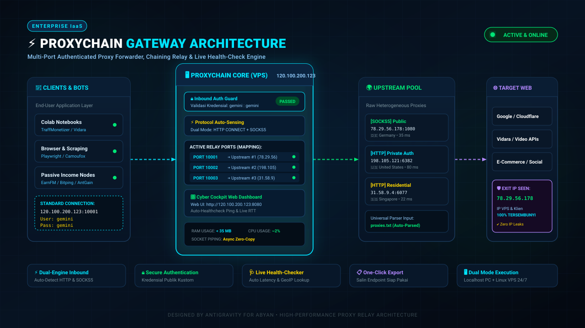

# ⚡ ProxyChain Gateway — Docker & Cloud Sandbox Edition

> **Multi-Port Authenticated Proxy Forwarder, Chaining Relay, Dual-Box Staging Lab & Live Health-Checker**  
> Didesain khusus untuk berjalan mulus di **Docker Container**, **Docker Cloud Sandbox (Agentic Platform)**, dan **VPS Linux**.

$$\text{Client / Bot} \longrightarrow \mathbf{HOST:PORT:USER:PASS} \longrightarrow \text{ProxyChain Relay} \longrightarrow \text{Upstream Proxy} \longrightarrow \text{Target Web}$$



---

## 🌟 Fitur Khusus Edisi Docker:
1. **🐳 Production-Ready Dockerfile & Compose:**
   - Base image `python:3.11-slim` yang ringan dan cepat.
   - Mendukung **Host Network Mode** (`network_mode: host`) di Linux VPS agar port dinamis (10001+) langsung terbuka tanpa batasan alokasi port Docker.
   - Volume persistence untuk `config.json`, `proxies.txt`, `proxies_active.txt`, dan `proxies_staging.txt`.
2. **☁️ Docker Cloud Sandbox 1-Line Installer (`install_sandbox.sh`):**
   - 100% kompatibel dengan container non-systemd seperti [Docker Agentic Sandboxes](https://agentic-platform.docker.com/sandboxes/new).
   - Menyiapkan daemon runner loop auto-restart di GNU screen.
   - CLI manajemen interaktif: `proxychain status`, `proxychain logs`, `proxychain restart`, dll.
3. **🌐 Dynamic Public Host / Override:**
   - Mendukung input *Public Host / IP (Optional)* langsung di Web Dashboard atau via environment variable `PROXYCHAIN_PUBLIC_HOST`.
   - Tombol **"📋 COPY ALL LIVE PROXY"** otomatis menyesuaikan format host (IP VPS, domain, atau `127.0.0.1` saat menggunakan SSH Tunnel).
4. **🔒 Keamanan Penuh:**
   - Seluruh port relay dilindungi autentikasi kustom (default: `gemini:gemini`).
   - Auto-sensing protokol: menerima koneksi **HTTP CONNECT** dan **SOCKS5** secara bersamaan di setiap port.

---

## 🚀 Panduan 1: Menjalankan via Docker Compose

### 🐧 Di VPS Linux (Rekomendasi Host Mode):
```bash
# 1. Masuk ke direktori
cd ProxyChain-Docker

# 2. Jalankan container di background
docker compose up -d

# 3. Pantau log
docker compose logs -f
```

Dashboard langsung dapat diakses di: `http://IP_VPS_ANDA:8080`

### 🪟 Di Windows / Mac Docker Desktop (Bridge Mode):
Buka file `docker-compose.yml`, aktifkan blok `ports:`, lalu jalankan:
```cmd
docker compose up -d
```
Akses di browser: `http://localhost:8080`

---

## ☁️ Panduan 2: Deploy di Docker Cloud Sandbox (Agentic Platform)

Jika Anda memiliki sandbox baru di **[Docker Agentic Platform](https://agentic-platform.docker.com/sandboxes/new)**:

### Metode A: Perintah 1-Baris di Terminal Sandbox
Cukup copy-paste perintah ini ke terminal SSH sandbox Anda:
```bash
curl -fsSL https://raw.githubusercontent.com/AbyanZainZ/ProxyChain-docker/main/install_sandbox.sh | bash
```

### Metode B: Deploy Otomatis dari Windows (PowerShell)
Jalankan skrip deployer:
```powershell
.\deploy_to_sandbox.ps1 -ConnectScript "path\ke\connect-sbx_XXXXX.ps1"
```

---

## 🔑 Cara Akses Dashboard Sandbox dari Laptop via SSH Tunnel

Karena Docker Cloud Sandbox berada di balik jaringan cloud Docker, Anda dapat membuat **SSH Tunnel** dari laptop Anda:

1. Buka PowerShell di laptop Anda, lalu jalankan:
   ```powershell
   ssh -N -L 8080:127.0.0.1:8080 -L 10001:127.0.0.1:10001 <user>@ssh.sandboxes-cloud.docker.com
   ```
2. Buka browser laptop Anda ke:
   👉 **`http://127.0.0.1:8080`**
3. Di dashboard, Anda bisa mengisi `Public Host` dengan `127.0.0.1`, sehingga ketika klik **COPY ALL LIVE PROXY**, formatnya langsung siap digunakan oleh bot di laptop Anda:
   `127.0.0.1:10001:gemini:gemini`

---

## 🛠️ Perintah CLI 'proxychain' (Di dalam Server/Sandbox)

Di terminal Linux atau container sandbox Anda, gunakan utilitas perintah:

| Perintah | Fungsi |
| :--- | :--- |
| **`proxychain status`** | Cek status runner, proses Python, penggunaan RAM/CPU, port aktif, dan 15 baris log |
| **`proxychain logs`** | Pantau log realtime secara live (`tail -f`) |
| **`proxychain start`** | Jalankan ProxyChain di background screen daemon |
| **`proxychain stop`** | Hentikan ProxyChain dan bebaskan semua port |
| **`proxychain restart`** | Restart daemon ProxyChain |
| **`proxychain attach`** | Masuk langsung ke screen session terminal |
| **`proxychain host <IP>`** | Ganti public host langsung dari terminal |

---

## ⚙️ Variabel Lingkungan (Environment Variables)

Anda dapat mengonfigurasi ProxyChain melalui file `.env` atau environment Docker:

| Variable | Default | Keterangan |
| :--- | :--- | :--- |
| `PROXYCHAIN_HOST` | `0.0.0.0` | Host bind address |
| `PROXYCHAIN_DASHBOARD_PORT` | `8080` | Port Web Dashboard Cyber Cockpit |
| `PROXYCHAIN_START_PORT` | `10001` | Port awal relay multi-port |
| `PROXYCHAIN_USER` | `gemini` | Username autentikasi inbound klien |
| `PROXYCHAIN_PASS` | `gemini` | Password autentikasi inbound klien |
| `PROXYCHAIN_PUBLIC_HOST` | *(Auto-detect)* | Override manual IP/Domain publik untuk tombol copy proxy |

---

## 🎛️ Dual-Box Architecture:
- **Box 1 (Production Relay Pool):** Proxy terverifikasi yang langsung membuka port relay aktif di server/container. Dilengkapi auto-purge proxy mati setiap 10 menit.
- **Box 2 (Scrape Testing Lab):** Tempat menguji puluhan/ratusan proxy baru hasil scrape tanpa mengganggu port produksi di Box 1. Proxy yang lolos uji (`ALIVE`) bisa dipindahkan ke Box 1 hanya dengan 1 kali klik!
